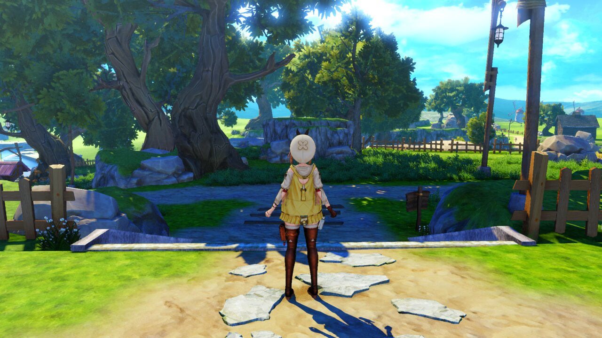
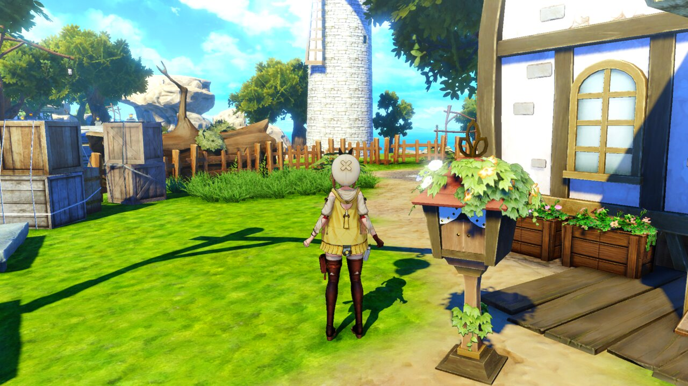

<div align="center">

# 🛢️ Barrel

### A native, open-source game engine for Gust's Atelier games, rebuilt from scratch in Rust and Vulkan

**Atelier Escha & Logy DX** · **Atelier Ryza DX** · and more of the series to come

[](LICENSE)


*Play the Atelier games you own natively on Linux, on low-end PCs and on ARM handhelds,
with modern upscaling and, in the future, built-in mod support.*



<sub>Atelier Ryza DX's Rasenboden, drawn by Barrel's own Vulkan renderer: no original code, no DirectX translation.</sub>

</div>

---

## What Barrel is

Barrel is a **from-the-ground-up reimplementation of the engine** behind Koei Tecmo and Gust's
Atelier games. It reads the files of your own Steam copy and plays the game with entirely new
code: a new renderer, audio mixer, event player, battle and synthesis rules, menus and file
readers, all written in Rust.

**It is not a static recompilation, a wrapper or an emulator.** None of the original program
runs. Every system was studied, documented and then written again, cleanly, and is checked
against the original until the two match.

|  | Static recomp / wrapper | **Barrel** |
|---|---|---|
| What runs | The original machine code, translated | New Rust code, written from scratch |
| Graphics | The original DirectX 11 calls, translated (DXVK and the like) | Its own Vulkan renderer, built for the hardware it runs on |
| CPU platforms | Usually x86 only | x86_64 and aarch64 (ARM) |
| Speed | The original's speed at best, plus translation costs | Free to do better: no translation layer |
| Mods | Patches to a program you can't read | Designed in: every file can be replaced, in formats you can edit |
| Lasting | Tied to one binary | Readable, documented, and open to anyone |

The goal is a game that **plays, looks and sounds the same** as the original, on an engine
that is **clean, fast and open**.

## Why

- 🐧 **Native on Linux.** No Proton, no Wine, no DXVK. One `barrel` program that finds your
  Steam library and starts the game.
- 🎮 **Built for low-end hardware.** Barrel is written for low-power devices: ARM (aarch64)
  Linux handhelds, older laptops, and Steam Deck-class machines. It has graphics presets for
  each tier (`desktop`, `desktop-high`, `handheld`) and a renderer tuned for small GPUs.
  Making the games run *faster than the original* on that hardware is a main goal.
- ✨ **Modern graphics features.** AMD FidelityFX Super Resolution 1 and 3, Snapdragon Game
  Super Resolution 1 and 2, temporal anti-aliasing, uncapped frame rates, any aspect ratio,
  and UI scaling for small screens. All of it is set in the game's own Options screen, not a
  launcher.
- 🧩 **Mod support as a core feature.** Every file the game reads goes through a layered file
  system, so mods can replace any table, event, script or asset by load order. More is
  planned (see [Mods](#-mods)).
- 📖 **Documented.** Every file format, table and rule that was worked out is written down in
  [`docs/`](docs/): thousands of lines on Gust's formats, the renderer and the game logic.

## Status

> Barrel is a work in progress. It is playable in parts, not yet a full replacement.

| Game | Steam | State |
|---|---|---|
| **Atelier Escha & Logy DX** | 2021 | **Playable** from the title screen through the opening into free play: fields, world and area maps, gathering, battles, the cauldron, shops, menus and saves. Runs on the desktop and on an aarch64 handheld. What's left: [`docs/escha/remaining.md`](docs/escha/remaining.md) |
| **Atelier Ryza DX** | 2023 | **In progress.** Boot screens, title screen and title menu match the original draw for draw; Rasenboden renders with the game's lighting, shadows, reflections and depth of field; Ryza walks it with the game's measured movement and camera. Next: performance on handhelds, then the HUD, menus and the opening |
| Atelier Shallie DX | 2021 | All its data reads (events, messages, tables) |
| Atelier Ayesha DX | 2021 | Its older PSSG data reads (meshes, textures, skeletons, motions) |
| Atelier Sophie 2, Ryza 2 DX, Ryza 3 DX | 2022–24 | Every texture, model, animation, event and message in their archives reads |

<p align="center">
  
</p>

### How "the same" is checked

Barrel is held to the original by measurement, not by eye. A reference build records what the
original does: every draw call and its constants, the player's position and camera each frame,
damage numbers in battle. Barrel's output is diffed against it. The Escha and Ryza scoreboards
cover the title, menus, HUD, fields, battles and movement. The method is in
[`docs/parity.md`](docs/parity.md).

Where Barrel differs from the original on purpose (a crash fixed, a limit lifted), the change
is listed in [`docs/engine.md`](docs/engine.md).

## 🎮 Playing

You need **your own copy** of the game (Steam). Barrel ships none of the game's files.

| Command | What it does |
|---|---|
| `./barrel` | Finds the game in your Steam libraries. One game: starts it. Several: a "Choose a game" list. None: a folder picker, remembered afterwards. |
| `./barrel --game "/path/to/Atelier Escha and Logy DX"` | Starts the game in that folder (a copy outside Steam, an SD card...). |
| `./barrel --preset handheld` | Starts with a graphics preset (`desktop`, `desktop-high`, `handheld`). After that, settings live in the game's Options screen. |
| Steam launch options: `"/path/to/barrel" %command%` | Steam starts Barrel in place of the game (on Linux, with any Proton selected). |

Saved game folders are listed in `games.toml` (`~/.config/barrel/`, or `%APPDATA%\barrel\` on
Windows). Settings, saves and mods per game: [`docs/mods.md`](docs/mods.md).

**Bringing a save over.** An Escha & Logy DX save from the original game carries over:

```sh
barrel-tool import-save INSTALL GAMEDATA00.pcsave > ~/.local/share/barrel/escha/saves/slot01.save
```

### Through Steam with Kintsugi

Barrel also runs as a [Kintsugi](https://github.com/daftblazer/kintsugi) engine. Kintsugi is a
Steam compatibility tool: force it in the game's *Properties → Compatibility*, and Steam starts
Barrel on the game's own files instead of the Windows game. No launch options are needed.
Escha & Logy DX (app 1152310) and Ryza DX (app 3365030) are wired up.

```sh
tools/deploy.sh                      # build for this machine and install the engine here
tools/deploy.sh user@host            # cross-build for aarch64 and install on a handheld over SSH
BARREL_GAME=ryza tools/deploy.sh     # the same for Ryza DX
```

On an aarch64 device the first start is fullscreen with the handheld preset. After that, the
in-game Options page decides. The log is `~/.local/state/barrel/barrel.log`.

## 🧩 Mods

Mod support is built into Barrel's foundations, not bolted on.

**Working now: layered files.** Every file Barrel reads goes through one layered file system:
the game's own files at the bottom and each enabled mod above them in load order. The topmost
copy of a path wins.

```text
mods/better-items/mod.toml                       name = "Better Items", version, what it needs
mods/better-items/Saves_EN/item/itemData.xml     replaces the game's file at that path
mods/better-items/Data/ZZ_extra.PAK              an extra archive
```

**Planned:**
1. **Standard formats.** PNG for textures, glTF for models, XML or JSON for tables and plain
   text for dialogue, converted on load, so mods are made with ordinary tools (an image
   editor, Blender, a text editor).
2. **`barrel-mod`**, a command-line tool: extract the game's files to those formats, start a
   mod from a template, check for errors and conflicts, and pack a zip to share.
3. **A Mods page** in the Options screen: on/off and load order.
4. **Logic mods**, once the games are complete: a scripting layer over Barrel's own systems.

Details: [`docs/mods.md`](docs/mods.md).

## 🔧 Building

Rust (stable), plus:
- `glslc` (shaderc, part of the Vulkan SDK) to compile the shaders (set `GLSLC` to use another path);
- SDL3, found through `pkg-config`.

```sh
cargo build --release
cargo test --release
```

Release packages: `tools/package.sh release` (Linux x86_64 and aarch64, Windows x86_64).
Cross-building for aarch64 needs an arm64 root filesystem in `BARREL_AARCH64_SYSROOT` and arm64
SDL3 in `BARREL_AARCH64_DEPS` (see `tools/package.sh`).

## 🗂️ How it's built

One Cargo workspace: one engine shared by every game, and each game's rules in its own crate.

| Crate | What it holds |
|---|---|
| `barrel` | The program: finds the installed games, shows the picker, starts one |
| `engine` | What every game shares: the event player, cameras, a Squirrel VM, walking and collision, skeletons, the clock |
| `render` | The Vulkan renderer: fields, characters, shadows, reflections, depth of field, TAA, FSR and GSR upscaling, text and 2D, the window and the pad |
| `formats` | Readers for Gust's file formats: containers, PAK archives, G1T textures, G1M models, motions, terrain, events, messages, XML tables, sound banks, Vorbis |
| `files` | The layered file system, mods, and finding the game's install |
| `audio`, `wma`, `movie` | The mixer and SDL3 output, Barrel's own WMA and Vorbis decoders, `.wmv` movies |
| `escha`, `ryza` | Each game's screens, rules and run loop |
| `parity` | The draw-trace diff tool that checks Barrel against the original |
| `cli` | `barrel-tool`, the data inspector |

### `barrel-tool`: look inside the game's data

```sh
barrel-tool scan     "<install>/Data"                # every container and what it holds
barrel-tool unpack   FILE.elixir.gz OUTDIR
barrel-tool pak-ls   "<install>/Data/PACK00_01.PAK"  # list an archive (Sophie 2, Ryza 1-3)
barrel-tool g1t      FILE.g1t OUTDIR                 # a texture pack as PNG files
barrel-tool g1m-obj  FILE.elixir.gz#N OUT.obj        # a model as OBJ
barrel-tool ebm-scan "<install>"                     # every dialogue line, all languages
barrel-tool xml-scan "<install>"                     # every XML table and its rows
barrel-tool recipes  "<install>/Atelier_Escha_and_Logy_EN.exe"   # the synthesis recipes
```

## 📚 Documentation

| Doc | About |
|---|---|
| [`docs/formats.md`](docs/formats.md), [`docs/tables.md`](docs/tables.md) | Gust's file formats and data tables |
| [`docs/events.md`](docs/events.md) | The event bytecode and its commands |
| [`docs/renderer.md`](docs/renderer.md), [`docs/shading.md`](docs/shading.md) | The renderer and the games' shaders, worked out |
| [`docs/engine.md`](docs/engine.md) | The engine's design and its deliberate differences from the original |
| [`docs/parity.md`](docs/parity.md) | How Barrel is checked against the original |
| [`docs/survey.md`](docs/survey.md) | The seven games and what each is built on |
| [`docs/escha/`](docs/escha/), [`docs/ryza/`](docs/ryza/) | Per-game scoreboards and open problems |

## 🤝 Contributing

Contributions are welcome. Good places to start are the open problems in
[`docs/escha/open.md`](docs/escha/open.md), [`docs/ryza/open.md`](docs/ryza/open.md) and
[`docs/open.md`](docs/open.md). Each one lists what was measured and what was already tried.

Two rules: **no game code or data in the repository** (your own copy supplies it at run time),
and Barrel's internals are its own design, never a copy of the original program's memory layout.

## Legal

Barrel is an independent, unofficial project. It is not affiliated with or endorsed by
Koei Tecmo or Gust. *Atelier* and the game titles are trademarks of their owners. Barrel
contains no code, art, sound or other data from the games: you need your own legally obtained
copy to play.

Barrel is free software: you can redistribute it and/or modify it under the terms of the
**GNU General Public License, version 3 or (at your option) any later version**. See
[`LICENSE`](LICENSE). Copyright © 2026 daftblazer.

### Third-party code

The renderer carries ports of two upscalers' shaders, with their notices in the shader sources
(`crates/render/shaders/`):

- **AMD FidelityFX Super Resolution 1.0** (`easu.frag`, `rcas.frag`): Copyright © 2021 Advanced
  Micro Devices, Inc., MIT License.
- **AMD FidelityFX Super Resolution 3.1** upscaler (`ffx/`, vendored unchanged from the
  FidelityFX SDK v1.1.4): Copyright © 2024 Advanced Micro Devices, Inc., MIT License
  (`ffx/LICENSE.txt`).
- **Snapdragon Game Super Resolution 1 and 2** (`gsr1.frag`, `gsr2_convert.frag`,
  `gsr2_upscale.frag`): Copyright © 2023-2024, Qualcomm Innovation Center, Inc., BSD 3-Clause
  License. Binary builds reproduce its notice, conditions and disclaimer as given in those files.

---

<div align="center">

*The name comes from the series' running "Barrel!" joke.* 🛢️

</div>
